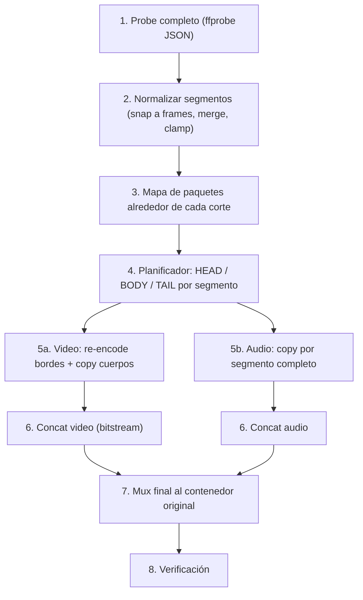

# SmartCut — Reescritura del sistema de exportación (modo Smart Cut)

> Objetivo de esta fase: **un único modo de exportación "Smart Cut"** que produzca un archivo
> **idéntico en formato al original** (mismo contenedor, códec, fps, resolución, perfil, bit depth,
> color, pistas de audio…), con **cortes exactos al frame** y re-codificando **solo los pocos
> segundos alrededor de cada corte** (de cada punto de corte hasta el keyframe más cercano).
> Todo lo demás se copia bit a bit (`-c copy`).

---

## 1. Concepto (cómo funciona un Smart Cut)

Un video H.264/H.265 está dividido en **GOPs**: cada GOP empieza en un keyframe (I/IDR) y los
frames siguientes dependen de él. Con `-c copy` solo se puede empezar a cortar en un keyframe,
por eso los cortes "saltan".

Para cada segmento que el usuario conserva `[IN, OUT]`:

```
 Fuente:  |K0.......|K1.........|K2.........|K3.........|K4......
                 IN ^                                ^ OUT
 Salida:         [ HEAD  ][        BODY (copy)       ][ TAIL ]
                 IN → K1   K1 ───────────────────→ K3   K3 → OUT
                 re-encode  copia sin pérdida            re-encode
```

| Parte | Rango (orden de presentación) | Tratamiento |
|---|---|---|
| **HEAD** | `IN` → justo antes del 1er keyframe usable `K1` | Re-codificar (corto: 0–1 GOP) |
| **BODY** | `K1` → justo antes del último keyframe usable `K3` | `-c copy` (bit a bit) |
| **TAIL** | `K3` → `OUT` | Re-codificar (corto: 0–1 GOP) |

Casos especiales:
- `IN` cae exactamente en un keyframe → no hay HEAD.
- `OUT` cae exactamente antes de un keyframe → no hay TAIL.
- No hay **dos** keyframes usables dentro del segmento (segmento corto o dos cortes dentro del mismo
  GOP) → **re-codificar el segmento completo** (sigue siendo pocos segundos).

> [!NOTE]
> La duración de HEAD/TAIL **no se elige**: la impone el GOP del archivo (normalmente 1–5 s;
> OBS/cámaras pueden tener GOPs de 10 s). El resultado siempre será correcto, solo más lento si el GOP es largo.

---

## 2. Diagnóstico del sistema actual (`src-tauri/src/export/engine.rs`)

Problemas detectados que explican **cortes inexactos** y **corrupción**:

| # | Problema | Efecto |
|---|---|---|
| 1 | El encoder de los bordes (NVENC/QSV/x264 por defecto) genera **SPS/PPS distintos** a los del original y en MP4 (`avc1`/`hvc1`) solo existe **un** juego de parámetros en la cabecera (`avcC`/`hvcC`). | Bloques verdes/grises, frames rotos en los empalmes. **Causa principal de corrupción en MP4.** |
| 2 | **Open GOP** (muy común en HEVC: keyframes CRA con frames RASL; también en H.264 con keyframes no-IDR). El BODY copiado arranca en un keyframe cuyos frames "leading" referencian el GOP anterior, que ya no existe. | Artefactos los primeros frames tras cada empalme; frames faltantes al final del BODY. |
| 3 | Se buscan keyframes con `ffprobe -show_frames … pts_time` y luego se pasan como **float con 6 decimales** a `-ss` en modo copy. Con input-seeking, ffmpeg salta al keyframe **≤** ese tiempo; un redondeo hacia abajo elige el **keyframe anterior**. | GOP duplicado / saltos de tiempo. |
| 4 | Intermedios en **MKV** (time base 1 ms). 59.94/29.97 fps no son representables en ms → jitter de timestamps; luego `+genpts` los regenera. | Saltos, stutter, desincronización. |
| 5 | **Audio cortado por slice** (`-c:a copy` en cada HEAD/BODY/TAIL). Los frames AAC (~21 ms) no coinciden con los límites de video. | Clics, huecos y deriva A/V acumulada en cada empalme. |
| 6 | `-r {:.4}` con fps float (29.97 ≠ 30000/1001) y aplicado también a fuentes **VFR** (celulares, OBS). | Deriva de timestamps / frames duplicados o perdidos. |
| 7 | `-avoid_negative_ts make_zero` en cada pieza + `+genpts+discardcorrupt` al unir. | Se "tapa" el problema en lugar de resolverlo; `discardcorrupt` tira paquetes. |
| 8 | Errores ignorados: `let _ = run_ffmpeg_with_fallback(...)` (modo clips individuales). | Exporta archivos rotos sin avisar. |
| 9 | Fallback que convierte el audio a AAC 192k si falla el copy. | Cambia el formato (va contra el objetivo). |
| 10 | El frontend fuerza `mkv` por defecto y envía encoder/CRF/preset. | El formato de salida no es el de entrada. |
| 11 | No se considera `start_time` del stream (MKV/TS suelen empezar en 0.067 s, 1.4 s, etc.). | El tiempo de la UI no coincide con el PTS real → corte desplazado. |
| 12 | No se considera la **rotación** (display matrix de celulares). Al re-codificar, ffmpeg auto-rota los bordes. | Bordes con resolución girada → corrupción/fallo al unir. |

---

## 3. Principios del nuevo diseño

1. **Nada cambia**: contenedor, códec, perfil, nivel, pix_fmt/bit depth, resolución, SAR, color/HDR,
   time base, fps (incluido VFR), pistas de audio, metadata, rotación.
2. **Trabajar en timestamps enteros (PTS en `time_base`)**, no en segundos float. Convertir a segundos
   solo para pasárselo a ffmpeg, y con margen de seguridad.
3. **El video se procesa por piezas; el audio por segmento** (nunca por pieza).
4. **El planificador es una función pura** (entrada: mapa de paquetes + cortes; salida: plan) →
   testeable con tests unitarios sin ffmpeg.
5. **Cualquier error aborta la exportación** con mensaje claro. Nada de `let _ =`.
6. **Verificación automática** al final (decodificar el resultado y contar frames).

---

## 4. Pipeline propuesto



### 4.1 Paso 1 — Probe completo

Un solo `ffprobe` al abrir el archivo (cachearlo):

```bash
ffprobe -v error -of json -show_format -show_streams -show_chapters input.ext
```

Guardar en un struct `SourceInfo`:

- **Formato**: `format_name`, `start_time`, `duration`, tags.
- **Video (v:0)**: `codec_name`, `profile`, `level`, `pix_fmt`, `width/height`, `sample_aspect_ratio`,
  `field_order`, `color_range/space/primaries/transfer`, `r_frame_rate` y `avg_frame_rate`
  **como string racional** (`"30000/1001"`), `time_base`, `start_time`, `has_b_frames`,
  `codec_tag_string` (`avc1`/`avc3`/`hvc1`/`hev1`), `side_data_list` (rotación, HDR mastering display, content light level, Dolby Vision).
- **Audio (todas las pistas)**: `codec_name`, `profile`, `sample_rate`, `channels`, `channel_layout`, `bit_rate`, `time_base`, `start_time`.
- **Subtítulos / attachments** (fuentes en MKV) / capítulos.

Detectar **VFR**: si `r_frame_rate != avg_frame_rate` de forma significativa → tratar como VFR (no usar `-r`).

### 4.2 Paso 2 — Normalizar segmentos

- Convertir tiempos de la UI a PTS: `pts = (t_ui + stream.start_time) / time_base` y **ajustar al frame
  más cercano** (con el mapa de frames, no con `t * fps`, para soportar VFR).
- Ordenar, **unir segmentos solapados o contiguos** (si entre un clip y otro hay 0 frames de hueco, es un solo segmento).
- Descartar segmentos de 0 frames; recortar a `[start_time, start_time+duration]`.
- Definir semántica: `IN` inclusivo, `OUT` exclusivo (el frame en `OUT` no se incluye). Mantenerla igual en UI y backend.

### 4.3 Paso 3 — Mapa de paquetes (clave para precisión y open GOP)

Por cada corte, leer solo una ventana (±1–2 GOPs) para no escanear todo el archivo:

```bash
ffprobe -v error -select_streams v:0 \
  -show_entries packet=pts,dts,duration,flags -of csv=p=0 \
  -read_intervals "<t-10>%<t+10>" input.ext
```

Con eso tienes, en **orden de decodificación**, cada paquete con `pts`, `dts` y `flags` (`K` = keyframe).

**Detección de open GOP** (sin parsear NALs): para un keyframe `K`, mirar los paquetes que vienen
**después** de `K` en orden de decodificación: si alguno tiene `pts < pts(K)` → son *leading pictures*
→ **GOP abierto**.

Consecuencias en el plan:
- **Inicio del BODY en un keyframe abierto**: sus leading pictures (RASL) no se pueden decodificar sin el GOP anterior.
  Como se muestran *antes* de `K`, su tiempo ya está cubierto por el HEAD → hay que **eliminarlas del BODY**.
  - HEVC: `-bsf:v filter_units=remove_types=8|9` (RASL_N / RASL_R).
  - H.264: no hay forma limpia por tipo NAL → **preferir keyframes IDR/cerrados**; si no hay, extender el HEAD hasta el siguiente keyframe cerrado.
- **Fin del BODY en un keyframe abierto `K3`**: los leading pictures de `K3` se muestran antes de `K3` pero se
  decodifican después → el BODY copiado (cortado en `K3` por orden de decodificación) **no los contiene**.
  Por eso el **TAIL debe empezar en `min(pts de las leading pictures de K3)`**, no en `pts(K3)`.

> [!IMPORTANT]
> El límite real entre piezas no es "el pts del keyframe", sino el **primer pts que la pieza siguiente
> debe aportar**. Calcúlalo siempre desde el mapa de paquetes.

### 4.4 Paso 4 — Planificador (función pura)

```rust
pub enum PieceKind { Encode, Copy }

pub struct Piece {
    pub kind: PieceKind,
    pub start_pts: i64,   // inclusivo, orden de presentación
    pub end_pts: i64,     // exclusivo
    pub frame_count: u32, // frames esperados (para verificar)
    pub drop_leading: bool, // eliminar RASL al inicio (solo Copy)
}

pub fn plan_segment(packets: &[Packet], in_pts: i64, out_pts: i64) -> Vec<Piece>;
```

Reglas:
1. `K1` = primer keyframe con `pts >= in_pts` utilizable (cerrado, o HEVC abierto con `drop_leading`).
2. `K3` = último keyframe con `pts < out_pts` utilizable.
3. Si no existen `K1 < K3` → una sola pieza `Encode [in, out)`.
4. Si `in_pts == pts(K1)` y K1 es cerrado → sin HEAD.
5. Opcional: si el BODY resultante es muy corto (< 1 GOP), re-codificar todo el segmento (menos empalmes = menos riesgo).
6. La suma de `frame_count` de las piezas debe ser igual a los frames de `[in, out)` → **assert**.

Tests unitarios obligatorios: corte en keyframe exacto, corte a mitad de GOP, dos cortes en el mismo GOP,
segmento de 1 frame, GOP abierto al inicio/fin, VFR, `start_time ≠ 0`, B-frames (pts ≠ dts).

### 4.5 Paso 5a — Video: piezas

**Formato intermedio**: usar **MPEG-TS (`.ts`)** solo con video (time base 90 kHz, parámetros SPS/PPS
in-band, concatenable). Evitar MKV (1 ms) como intermedio.

**Piezas `Copy`** (sin re-codificar):

```bash
ffmpeg -v error -ss <pts(K1) + medio_frame> -i input.ext -map 0:v:0 -c:v copy \
  -frames:v <frame_count> [-bsf:v filter_units=remove_types=8|9] \
  -copyts -f mpegts body_N.ts
```

- `-ss` **un poco después** del keyframe (+ medio frame): con input seeking en modo copy ffmpeg retrocede al keyframe ≤ t, así nunca cae en el anterior por redondeo.
- Limitar por **número de frames** (`-frames:v`) en vez de `-t` → exacto incluso con B-frames.
- Para MP4/MOV de entrada: el muxer TS aplica `h264_mp4toannexb`/`hevc_mp4toannexb` automáticamente.

**Piezas `Encode`** (bordes):

```bash
ffmpeg -v error -noautorotate -ss <start - margen> -i input.ext -map 0:v:0 \
  -vf "trim=start_pts=...:end_pts=...,setpts=PTS" \
  <encoder_args_que_replican_el_original> -copyts -f mpegts edge_N.ts
```

- `-ss` antes de `-i` con margen (p.ej. 1 GOP antes) y el corte exacto con `trim` por frames/pts → precisión de frame. (Alternativa más simple: `-ss` exacto + `-frames:v N`; ffmpeg decodifica desde el keyframe previo y descarta hasta el tiempo pedido.)
- `-noautorotate` para que la rotación siga siendo metadata y no se aplique a los píxeles.
- **No** usar `-r` en VFR; usar `-fps_mode passthrough` y conservar los pts originales.

**Argumentos del encoder (replicar el original)** — función `build_matching_encoder_args(&SourceInfo)`:

| Propiedad | H.264 (`libx264`) | H.265 (`libx265`) |
|---|---|---|
| Perfil | `-profile:v high/main/baseline` | `-profile:v main/main10` |
| Nivel | `-level <level>` | `-x265-params level-idc=<level>` |
| Bit depth / chroma | `-pix_fmt yuv420p / yuv420p10le / yuv422p…` | ídem |
| Color | `-color_range -colorspace -color_primaries -color_trc` | ídem + `master-display`, `max-cll` si es HDR |
| SAR / campo | `-aspect`/`setsar`, `field_order` | ídem |
| GOP cerrado | `-x264-params open-gop=0` (por defecto) | `-x265-params no-open-gop=1:repeat-headers=1` |
| Cabeceras in-band | `-bsf:v dump_extra` / salida TS | `repeat-headers=1` |
| Calidad | `-crf 14–16 -preset medium` | `-crf 16–18 -preset medium` |
| Time base | `-enc_time_base` = time base original | ídem |

> [!TIP]
> Usar **encoder por CPU** (`libx264`/`libx265`) para los bordes: son pocos segundos, la diferencia de
> velocidad con NVENC es irrelevante y permite controlar perfil/nivel/GOP con precisión. NVENC/QSV pueden
> quedar como opción futura. Usar CRF bajo para que el borde no se note frente al original.

Otros códecs (VP9/AV1 en MKV/WebM, MPEG-2, ProRes…): fase posterior. Para esta fase, si el códec no es
H.264/H.265 → **mostrar aviso** y no permitir Smart Cut (o exportar solo con copy a keyframes).

### 4.6 Paso 5b — Audio (por segmento, nunca por pieza)

Por cada **segmento** y cada pista de audio:

```bash
ffmpeg -v error -ss <IN> -i input.ext -map 0:a:<n> -c:a copy -t <OUT-IN> audio_seg_<s>_<n>.mka
```

- Un solo corte por segmento → **ningún empalme de audio dentro de un segmento**.
- Error máximo ≈ 1 frame de audio (AAC 1024 muestras ≈ 21 ms a 48 kHz; AC3 32 ms) → imperceptible.
- **Compensación de deriva**: medir la duración real copiada de cada segmento (suma de duraciones de
  paquetes) y ajustar el `IN` del siguiente segmento para que el error **no se acumule** con muchos clips.
- Opus tiene *pre-skip*: verificar que el corte por copy no deje silencios; si da problemas, tratarlo como caso especial.
- Opción avanzada (no por defecto): re-codificar solo el audio con el **mismo códec y bitrate** para precisión absoluta (es barato).

### 4.7 Paso 6 — Concatenación

- **Video**: lista de piezas `.ts` en orden → concat demuxer (o protocolo `concat:`), `-c copy`.
  Regenerar timestamps continuos con el bsf `setts` o restando el offset de cada pieza; **no** usar `discardcorrupt`.
- **Audio**: concat demuxer de los `audio_seg_*` por pista, `-c copy`.

### 4.8 Paso 7 — Mux final al contenedor original

```bash
ffmpeg -v error -i video_concat.ts -i audio_0.mka [-i audio_1.mka ...] -i input.ext \
  -map 0:v -map 1:a [-map 2:a ...] \
  -map_metadata <idx_input> -map_chapters -1 \
  -c copy <flags_contenedor> output.<ext_original>
```

Flags por contenedor:

| Contenedor | Flags / notas |
|---|---|
| **MP4/MOV/M4V** | `-movflags +faststart`. Etiqueta de video: si los bordes tienen SPS distinto al original usar **`avc3` / `hev1`** (parámetros in-band, permite cambios de SPS). `hvc1` solo si se garantiza SPS idéntico (QuickTime/Safari lo exigen). Restaurar rotación con `-display_rotation` (input) o metadata. `-video_track_timescale` = time base original. |
| **MKV** | Tolera bien SPS in-band (`dump_extra`). Copiar attachments (`-map 2:t`) y subtítulos. |
| **WebM** | Solo VP8/VP9/AV1 + Opus/Vorbis → fuera de esta fase. |

- Capítulos: descartarlos en esta fase (`-map_chapters -1`) o recalcularlos según los segmentos.
- Subtítulos: fase 2 (cortar por segmento como el audio, `-c:s copy`).
- Escribir primero a `output.tmp.<ext>` y **renombrar** al terminar (si se cancela no queda un archivo corrupto con el nombre final).

### 4.9 Paso 8 — Verificación

```bash
# 1. Que decodifique sin errores
ffmpeg -v error -i output.ext -f null - 2> errores.txt   # vacío = OK
# 2. Que tenga los frames esperados
ffprobe -v error -select_streams v:0 -count_packets -show_entries stream=nb_read_packets -of csv=p=0 output.ext
# 3. Que el formato coincida con el original
ffprobe -v error -show_streams -of json output.ext   # comparar con SourceInfo
```

- Si hay errores de decodificación o el conteo de frames no coincide → reportar al usuario (no "éxito silencioso").
- En desarrollo: comparar `framemd5` de los rangos copiados contra el original (deben ser **idénticos**) y
  el primer/último frame de cada borde con SSIM/PSNR.

---

## 5. Arquitectura propuesta (Rust / Tauri)

```
src-tauri/src/export/
├── mod.rs
├── probe.rs        # SourceInfo (ffprobe JSON → structs), detección VFR/rotación/HDR
├── packets.rs      # mapa de paquetes por ventana (pts, dts, flags), detección open GOP
├── planner.rs      # FUNCIÓN PURA: segmentos → piezas HEAD/BODY/TAIL (+ tests)
├── encoder.rs      # build_matching_encoder_args(&SourceInfo) para x264/x265
├── runner.rs       # spawn ffmpeg, -progress pipe:1, cancelación, captura stderr
├── assemble.rs     # concat de video/audio + mux final por contenedor
├── verify.rs       # verificación post-export
└── temp.rs         # TempDir con Drop (limpieza garantizada incluso con error/cancelación)
```

- Comando Tauri único: `export_smartcut(options) -> Result<ExportReport, ExportError>`.
- `ExportOptions` mínimo: `input_path`, `output_path`, `segments: Vec<{ start, end }>` (segundos de UI) — **sin** encoder/CRF/contenedor.
- `ExportError` tipado (enum con `thiserror`) en lugar de `String` → mensajes claros en la UI.
- Progreso: pesos por pieza proporcionales a su costo (Encode ≫ Copy) para que la barra sea realista.
- Cancelación: mantener la `Child` actual + flag atómico (como ahora) y limpiar temporales vía `Drop`.
- Paralelismo (opcional): los bordes son independientes → se pueden codificar en paralelo (2–4 hilos).
- Mantener `plan_smart_slices` y similares **fuera** del código de ejecución para poder testearlos.

## 6. Cambios en el frontend (Vue)

- `useExport.ts`: eliminar `containerFormat`, `crf`, `preset`, `selectedEncoder`, `mode` para esta fase.
- Extensión de salida = **extensión del archivo de entrada** (`video.mkv` → `video_smartcut.mkv`).
- `pick_save_path`: filtro solo con la extensión original.
- Enviar `segments` en segundos de la UI tal cual; el backend hace el snap a frames con el mapa real.
- Mostrar en el modal un **resumen del plan** antes de exportar (opcional pero útil):
  "3 segmentos · 5.2 s se re-codificarán · 12:34 se copiarán sin pérdida".
- Mostrar el `ExportReport` final (frames verificados, advertencias).
- Asegurar que el tiempo mostrado/seleccionado en la UI corresponde al frame que se exportará
  (mismo `start_time`, misma convención IN inclusivo / OUT exclusivo).

## 7. Matriz de pruebas

Generar archivos de prueba con ffmpeg para cubrir los casos difíciles:

```bash
# H.264 60 fps, GOP 2 s, B-frames, MP4
ffmpeg -f lavfi -i testsrc2=size=1920x1080:rate=60 -f lavfi -i sine=f=440:r=48000 -t 60 \
  -c:v libx264 -g 120 -bf 3 -c:a aac t_h264_60.mp4
# HEVC 10-bit, open GOP, MKV
ffmpeg -f lavfi -i testsrc2=size=1920x1080:rate=30000/1001 -f lavfi -i sine -t 60 \
  -c:v libx265 -pix_fmt yuv420p10le -x265-params keyint=120:open-gop=1 -c:a aac t_hevc10_open.mkv
# GOP largo (estilo OBS) y VFR
ffmpeg -f lavfi -i testsrc2=rate=30 -t 60 -c:v libx264 -g 300 t_long_gop.mp4
```

| Caso | Qué validar |
|---|---|
| Corte en keyframe exacto | No hay HEAD; framemd5 idéntico |
| Corte a mitad de GOP | Primer frame = frame exacto de la fuente |
| Dos clips con < 2 s de separación / mismo GOP | Re-encode completo del tramo, cortes exactos |
| Segmento de 1 frame | Exporta 1 frame |
| HEVC open GOP | Sin artefactos tras los empalmes |
| 29.97 / 59.94 fps | Sin deriva ni frames duplicados |
| VFR (video de celular) | Timestamps preservados |
| Video rotado (celular vertical) | Misma orientación y resolución |
| HDR / 10-bit | Mismo pix_fmt, metadatos HDR |
| Varias pistas de audio | Todas presentes y sincronizadas |
| 20+ clips | Sin deriva A/V acumulada |
| `start_time ≠ 0` (MKV/TS) | Corte en el frame correcto |
| Cancelación a mitad | No quedan temporales ni archivo final corrupto |

Reproductores para probar: **mpv, VLC, navegador (Chrome), reproductor del sistema**, y re-importar el
archivo en SmartCut.

## 8. Hoja de ruta (orden recomendado)

1. **`probe.rs` + `packets.rs`** con tests sobre los archivos de prueba.
2. **`planner.rs`** (pura) + tests unitarios de todos los casos de la sección 4.4.
3. **Video solo, H.264, MKV**: bordes + copy + concat → validar con `framemd5`.
4. **Audio por segmento** + mux final + compensación de deriva.
5. **MP4/MOV**: etiquetas `avc3/hev1`, `faststart`, rotación, timescale.
6. **HEVC** (8/10-bit, open GOP con `filter_units`).
7. **Verificación** automática + `ExportReport`.
8. **Frontend**: simplificar modal, extensión original, resumen del plan.
9. Eliminar el código antiguo (`reencode`, `individual_clips`, fallbacks AAC) o dejarlo detrás de un flag hasta que el nuevo esté probado.
10. Futuro: subtítulos, capítulos, NVENC/QSV para bordes, VP9/AV1, clips individuales.

## 9. Riesgos conocidos y decisiones

| Riesgo | Mitigación |
|---|---|
| Parámetros del borde ≠ original (SPS) | Cabeceras in-band; MP4 con `avc3`/`hev1`; igualar perfil/nivel/pix_fmt |
| Reproductores que no aceptan `hev1` (QuickTime/Safari) | Documentarlo; opción futura de "modo compatibilidad Apple" |
| GOPs muy largos → bordes de 10+ s | Aceptable; mostrar estimación en el resumen del plan |
| Fuentes con errores/corruptas de origen | La verificación lo detecta y avisa; no ocultar con `discardcorrupt` |
| Códecs no soportados | Detectar en el probe y avisar antes de exportar |
| Versión de ffmpeg | Requerir ffmpeg ≥ 6 (`-fps_mode`, `setts`, `filter_units`); el sistema actual tiene 9.0.2 — comprobar al iniciar la app |
